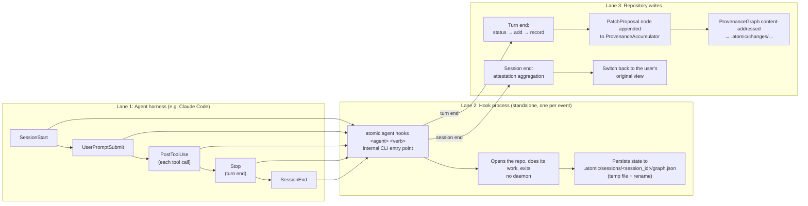

# AI Agent Workflows with Atomic

Atomic has built-in support for AI coding agents. When enabled, every agent turn is automatically recorded as an Atomic change with full provenance: model, provider, tokens, cost, session tracking, and a causal decision graph explaining why the agent made each change.

No manual flags. No wrapper scripts. No environment variables.

## Quick Start

### 1. Install an Agent Integration

Install the adapter for your agent with one command:

```bash
# Install a specific agent's integration
atomic agent enable --agent opencode

# Or let Atomic detect the agent from directories like .claude/ or .cursor/
atomic agent enable
```

`enable` fetches the integration package from Atomic storage and installs its hooks, plugins, extensions, skills, and instruction files. No clone, no `npm`/`npx`, no shell script. Supported agents:

| Integration | Agent | Install Model | Notes |
|-------------|-------|---------------|-------|
| **atomic-agy** | Antigravity CLI | Plugin (hooks + skills) | Writes a managed `AGENTS.md` section |
| **atomic-claude** | Claude Code | Hooks + skills | Auto-detected from `.claude/` |
| **atomic-cline** | Cline | Hook scripts | Enable hooks in Cline's VS Code Hooks tab |
| **atomic-codex** | Codex | Hooks + feature flag | Codex hook support is experimental |
| **atomic-copilot** | GitHub Copilot | Repository hook manifest | Manifest must be on the default branch for the cloud agent |
| **atomic-cursor** | Cursor | Hooks + rules | Follows the Atomic intent workflow in-project |
| **atomic-devin** | Devin | Hook wiring | — |
| **atomic-grok** | Grok Build | Global hooks + rules + skills | Installs to `~/.grok/`; requires CLI >= 0.12.0 |
| **atomic-kilo** | Kilo Code | Rules + agent config | Reads `.kilo/` config |
| **atomic-kiro** | Kiro | IDE steering + hooks | Configure hooks in the Kiro IDE panel |
| **atomic-opencode** | OpenCode | Plugin + agent + skills | Select the Atomic agent in OpenCode |
| **atomic-pi** | Pi | Pi extension | Activates in Atomic repositories |

→ [Install an agent integration](/agents/installing-agent-integrations)

All integrations call back to `atomic agent hooks <agent> <verb>` (an internal command you should never need to run yourself) on lifecycle events.

All integrations share the same Rust-side orchestrator (`TurnOrchestrator`). The only difference is how each agent reports lifecycle events and how project instructions are discovered. Each adapter normalizes events into common `TurnEvent` values before Atomic records provenance.

### 2. Work Normally

Use your agent as you always do. Atomic hooks fire automatically:

- **Session start** → creates an isolated agent view forked from your current view
- **User prompt** → records a Goal node in the provenance graph
- **Each tool call** → records Exploration, Commitment, or Verification nodes
- **Turn end** → runs status → add → record, saves a provenance graph
- **Session end** → creates an attestation, switches back to your view

### 3. Review What Happened

```bash
# See the recorded changes with AI provenance
atomic log

# Check session and hook status
atomic agent status --verbose

# Inspect attestations (cost, tokens, model breakdown)
atomic agent attest

# View details for a specific attestation
atomic agent attest --hash XMJZ3IPF

# Generate AI reasoning summaries
atomic agent explain <session-id> --all --save
```

## Agent Isolation with Views

When a session starts, Atomic automatically creates an **isolated agent view** forked from the current view:

```
  dev  (Shared — your working view)
    │
    └── agent-ses_3781fc7a... (Draft, parent: dev)
          ├── Turn 1: Change ABC123
          ├── Turn 2: Change DEF456
          └── Turn 3: Change GHI789
```

The agent view uses the [single GRAPH + view filter model](/concepts/graph-model-explained):
- All edges are stored in the canonical `GRAPH` (single source of truth)
- The agent view's change filter determines which edges are visible
- The agent sees the parent view's changes plus its own: full project context with isolated changes

When the session ends, Atomic switches back to your original view. You then decide what to promote:

```bash
# Insert specific changes from the agent view into dev
# (--to-view is the canonical flag; --to is an accepted alias)
atomic insert change <change-hash> --to-view dev

# Or insert the most recent change
atomic insert change @~1 --to-view dev

# Delete the agent view — removes VIEW_CHANGES entries, orphaned edges cleaned by GC
atomic view delete agent-ses_3781fc7a...
```

:::tip Review Before Promoting
Agent changes live on an isolated view. Review them before inserting into your shared view:

```bash
# See what the agent changed
atomic log --view agent-ses_3781fc...

# Diff against the parent
atomic diff --view agent-ses_3781fc...

# Insert only the changes you want
atomic insert change <hash> --to-view dev
```
:::

## What Gets Recorded

Every agent turn produces an Atomic change containing:

| Data | Location | Description |
|------|----------|-------------|
| **Change header** | `hashed.header` | Message, author (e.g., `claude+60f5 <you@dev>`), timestamp |
| **Provenance** | `hashed.provenance` | Model, provider, session ID, turn number |
| **Session envelope** | `hashed.metadata` | Turn timing, files touched, agent identity |
| **Graph operations** | `hashed.atoms` | The actual content changes (vertices + edges) |
| **Semantic operations** | `hashed.file_ops` | Line and token-level operations for human-readable diffs |
| **Transcript** | `unhashed` | Condensed conversation (redactable, doesn't affect hash) |

Because provenance and the session envelope are in the **hashed** section, they're part of the change's cryptographic identity. Tampering with attribution changes the hash.

## How Agent Recording Works



The **TurnOrchestrator** is Atomic's Rust-side state machine that normalizes each harness's lifecycle events into common `TurnEvent` values and drives recording. The **ProvenanceAccumulator** is the in-progress provenance graph for the current session: the buffer of Goal, Exploration, Commitment, and Verification nodes that each hook invocation appends to.

Exact event names differ per harness: Grok fires all six lifecycle events, while agy fires `PreInvocation`, `Stop`, and `PostToolUse`. Each adapter maps its harness's events onto the same internal verbs.

Each hook invocation is a separate process; no daemon required. The provenance accumulator is persisted to `.atomic/sessions/{session_id}/graph.json` between invocations using atomic writes (temp file + rename).

:::tip Let Atomic Handle Recording
Don't run `atomic record` manually during agent sessions; the hooks do this automatically on each turn end. Manual recording can interfere with the session state machine.
:::

## Provenance Graphs

Every agent session builds a **causal decision DAG**: it records what changed and why.

```
Goal: "Fix the authentication bug"
  ├── Exploration: read src/auth.rs
  ├── Exploration: grep "verify_token"
  ├── Commitment: edit src/auth.rs (fix token validation)
  ├── Verification: bash "cargo test"
  └── PatchProposal: Change XMJZ3IPF (2 files)
```

Tool calls are classified automatically by a rule-based classifier:

| Tool | Classification |
|------|---------------|
| `read`, `grep`, `glob`, `list_directory` | **Exploration**: read-only understanding |
| `edit`, `write`, `edit_file`, `create_file` | **Commitment**: file-modifying actions |
| `bash` with `test`, `check`, `lint` | **Verification**: validation |
| `bash` with `install`, `build` | **Execution**: non-test commands |

Causal edges are inferred automatically: explorations link to the current goal, commitments link to preceding explorations, verifications link to the last commitment.

Provenance graphs are content-addressed and pushed to remotes alongside the changes they explain. Your team can review the code and the reasoning behind it.

→ [Learn more about Provenance Graphs](/agents/provenance)

## Attestations

When a session ends, Atomic creates an **attestation**, a graph-level audit node covering the session:

```bash
$ atomic agent attest

  XMJZ3IPF OpenCode · claude-sonnet-4-5 · 12.4k tokens · 3m 42s · 2 changes
  R3KQP7YN Claude Code · claude-sonnet-4-5 · 8.1k tokens · 1m 15s · 1 change

──────────────────────────────────────────
Total: $0.27 · 3 changes covered · 20.5k tokens
```

Attestations are enriched with real data from the provenance entries embedded in each covered change:

- **Model name and provider** from change provenance
- **Token counts** (input, output, cache read/write) aggregated per model
- **Cost in USD** aggregated across all models
- **Lines added/removed** computed from the CRDT semantic layer
- **Wall duration** from session timestamps

For resumed sessions, the new attestation chains to the previous one via `previous_attestation`, ensuring every change is covered exactly once.

→ [Learn more about Attestations](/agents/attestations)

:::tip Use Explain for Complex Sessions
For long or complex sessions, generate reasoning summaries:

```bash
# Generate reasoning for all turns and save to the changes
atomic agent explain <session-id> --all --save
```

This stores structured reasoning (intent, outcome, learnings, friction) in the change's unhashed section and appends learnings to the agent's context file (`CLAUDE.md`, `GEMINI.md`, or `opencode.md`).
:::

:::tip Check Attestations Before Code Review
Attestations give reviewers context about the AI session that produced the code:

```bash
$ atomic agent attest --hash XMJZ3IPF --verbose

# Shows: model, tokens, cost, duration, files changed, coverage per view
```

This is especially useful when reviewing pull requests: you can see exactly how much AI assistance was involved and what model was used.
:::

## Agent Identity

Agent changes are attributed using Ed25519 signatures with a `+tag` email format:

```
User identity:    Lee Faus <lee@atomic.dev>
Agent author:     claude+60f5 <lee@atomic.dev>
```

The `+tag` is a short hash of the session ID: every agent turn traces back to a specific session and a specific human who initiated it.

| Agent | Example Author |
|-------|---------------|
| Claude Code | `claude+60f5 <lee@atomic.dev>` |
| Gemini CLI | `gemini+abcd <lee@atomic.dev>` |
| Grok Build | `grok+019f <lee@atomic.dev>` |
| OpenCode | `opencode+9876 <lee@atomic.dev>` |

## Pushing Agent Data

When you push changes, Atomic automatically uploads attestations and provenance graphs:

```bash
$ atomic push origin

  ✓ Pushed 3 changes
  ✓ XMJZ3IPF attestation ($0.15, 3 covered)
  ✓ ABC12345 provenance (7 nodes, 1 change)
  ✓ DEF67890 provenance (12 nodes, 1 change)
```

Attestations are only uploaded when all their covered changes have been pushed. Provenance graphs are only uploaded when all their explained changes have been pushed. This ensures the server never references data it doesn't have.

## Differences from Git

| | Git | Atomic |
|---|---|---|
| **AI attribution** | `Co-authored-by` trailer (prose) | Structured provenance in hashed change data |
| **Cost tracking** | Not possible | Per-model token and cost breakdown in attestations |
| **Agent reasoning** | Not tracked | Causal provenance graph (goal → exploration → commitment) |
| **Turn recording** | Manual `git commit` or wrapper scripts | Automatic on each turn end |
| **Agent isolation** | Branches (diverge, need merging) | Views (filtered perspectives on same graph, zero-orphan cleanup) |
| **Conflict granularity** | Whole lines | Token-level (two agents editing different tokens on same line merge cleanly) |
| **Identity** | Name + email string | Ed25519 cryptographic identity with delegation |

## Best Practices Summary

- **Let Atomic handle recording**: the hooks record automatically on each turn end; don't run `atomic record` manually during agent sessions.
- **Review before promoting**: agent changes live on an isolated view; review with `atomic log --view` / `atomic diff --view` and insert only the changes you want.
- **Use Explain for complex sessions**: generate reasoning summaries with `atomic agent explain <session-id> --all --save`.
- **Check attestations before code review**: `atomic agent attest --hash <hash> --verbose` shows model, tokens, cost, duration, files changed, and coverage per view.

## Troubleshooting

### Agent Hooks Not Firing

```bash
# Check installation and observed hook outcomes
atomic agent status

# Inspect per-session failures and details
atomic agent status --json

# Reinstall hooks
atomic agent enable --force
```

Installed hooks can still fail when they run. Inspect the affected session in
`hook_sessions`, including its failing verb's `detail` and `last_ok`. A child
session's success cannot clear a parent's failure. If the service is unavailable,
`hook_health_error` explains the partial report and pending observations remain
inspectable. See [Hook Health and Troubleshooting](/agents/hook-health).

### Session Not Recording Changes

The state machine requires `TurnStart` (user prompt) before `TurnEnd` (stop) will trigger recording. If you see "Turn N had no changes — skipping record" in stderr, the agent didn't modify any files during that turn. This is normal for read-only turns.

### Attestation Shows Zero Cost/Tokens

If the attestation shows `$0.00` and `0 tokens`, the provenance entries in the changes may not have token/cost data. This happens when the agent doesn't report usage metrics through its hook payload. The attestation will still show the correct model name, changes covered, and lines changed.

### Agent View Not Created

Failure to prepare or align a required agent view is reported rather than
silently recording onto another view. Inspect the session's hook failure detail
with `atomic agent status --json`, correct the reported cause, and retry the
affected hook.

## Next Steps

- [Agent Integration Overview](/agents/overview): How Atomic records what your agent did
- [Installing Agent Integrations](/agents/installing-agent-integrations): Per-agent setup notes and the integration matrix
- [Provenance Graphs](/agents/provenance): Deep dive into causal decision DAGs
- [Attestations](/agents/attestations): Session-level audit and cost tracking
- [`atomic agent` command reference](/commands/agent): Full CLI documentation
- [Atomic Vault](/getting-started/atomic-vault): The intent and review workflow agents follow
- [Comparison with Git](/getting-started/comparison-with-git): Why patch theory matters for agents
