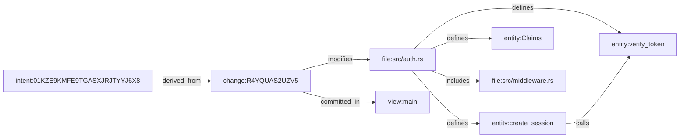

# Querying the Knowledge Graph

After you import or create a repository, Atomic can build a **knowledge graph** (KG) from your codebase. The knowledge graph maps out your files, functions, structs, classes, changes, views, modules, and the relationships between them: who changed what, which file defines which entity, and what depends on what.

This is a queryable model of your entire project that powers:

- **Code search**: find source text across your repo with content indexing
- **Structural search**: find entities by name, kind, or relationship
- **Dependency exploration**: trace how files, changes, and entities connect
- **AI agent workflows**: agents use the KG instead of grep/find for faster, more accurate code discovery

This page is organized by **what you want to do**: set up the graph, find code, explore relationships, visualize, and automate. All of the commands below live under a single command family: `atomic query`.

:::note
`atomic vault query …` is a documented alias for `atomic query …`. Both forms work identically. This page uses the canonical `atomic query <subcommand>` form throughout.
:::

:::info
The knowledge graph is especially important for [AI Agent Workflows](/getting-started/ai-agent-workflows). Agent integrations install a code-intelligence skill that teaches agents to query the KG instead of scanning the filesystem. If you're setting up Atomic for agent use, this page is essential reading.
:::

## How the graph is organized

Before querying, it helps to know what the graph contains. The knowledge graph stores several kinds of nodes:

- **`file`**: every tracked file in the repository
- **`entity`**: functions, structs, classes, constants, and other code structures extracted with tree-sitter
- **`change`**: every recorded change, with author and message
- **`view`**: views in the repository (main, dev, feature branches)
- **`intent`**: directive-based units of work from the [Atomic vault](/getting-started/atomic-vault)
- **`memory`**: durable knowledge captured alongside the work
- **`goal`**: goals that group and track work

Every node has a typed ID of the form `kind:identifier`. You'll use these with `neighbors`, `callers`, and anywhere else a node ID is expected:

| Prefix | Format | Example |
|--------|--------|---------|
| `entity:` | `entity:<file>:<name>:<line>` | `entity:src/auth.rs:verify_token:42` |
| `file:` | `file:<path>` | `file:src/auth.rs` |
| `change:` | `change:<hash>` | `change:R4YQUAS2UZV5` |
| `view:` | `view:<name>` | `view:main` |
| `intent:` | `intent:<ULID>` (upper-cased) | `intent:01KZE9KMFE9TGASXJRJTYYJ6X8` |
| `memory:` | `memory:<ulid>` (as stored) | `memory:01kze82jaq8b4akzagvqpqpswj` |

:::warning
An intent's node ID is its **ULID**, not its human key. A human key like `TRAI::lee::4` is for CLI lookup and conversation only: `intent:TRAI::lee::4` will **not** resolve as a node ID; the real ID is `intent:01KZE9KMFE9TGASXJRJTYYJ6X8`. Use `atomic query search` to discover the exact ID first. See [Train Tracks demo](/getting-started/train-tracks-demo) and [The Atomic Vault](/getting-started/atomic-vault) for the four identity forms of an intent (human key, bare UID, canonical RDF identity, and KG node ID).
:::

Edges connect these nodes and encode the relationships between them: a file **defines** its entities, a change **modifies** files, an intent **derives from** the changes that implemented it. The full list of edge types is in [Edge types](#edge-types) at the end of this page.

## Set up the graph

Before you can query anything, you need to populate the knowledge graph and keep it fresh as your code and vault change. This section covers when and how.

### `enrich`: build the knowledge graph

Run:

```bash
atomic query enrich
```

This builds the graph from what the repository actually contains:

```
Enriching views... ✓ 3 view(s)
Enriching files... ✓ 42 file(s)
Enriching changes... ✓ 15 change(s)
Building content index... ✓ 42 file(s) indexed (1.2 MB)

Enriched: 3 views, 42 files, 15 changes
```

Here's what each phase does:

| Phase | What it extracts |
|-------|-----------------|
| **Views** | All views in the repository (main, dev, feature branches) |
| **Files** | Every file touched by a recorded change, with path metadata |
| **Changes** | Every recorded change, with author and message |
| **Content index** | Full-text search index over the files it includes (see exclusions below) |

Structural queries — entity outlines, callers, import relationships — are parsed from file contents on demand at query time, so there is no separate phase to run for them.

You can re-run `enrich` at any time to pick up new changes. It's idempotent.

### Keeping the graph fresh: when to run what

Which maintenance command you need depends on what has drifted:

- **Fresh clone, or after importing a Git repository or a large pull?** Run `enrich` to populate the KG. The KG doesn't update automatically. You control when it rebuilds.
- **Code search results look stale?** Run `atomic query index --rebuild` to fully rebuild the content index (or `atomic query index --stats` for an incremental update plus statistics).
- **Using semantic/RAG features like `ask`?** Run `atomic query embed` to (re)build the embeddings that power semantic search.
- **Vault content changed (new intents or memories)?** Run `atomic query reindex` to rebuild the KG index from vault entries, and `atomic vault sync` if you also need to sync the vault itself.

### `index`: update the content search index

```bash
atomic query index --stats
```

```
Updating content index... done.
  files: 42, segments: 3, index size: 1.2 MB
```

| Flag | Description |
|------|-------------|
| `--rebuild` | Full rebuild instead of incremental update |
| `--stats` | Show index statistics after building |

### `reindex`: Rebuild the KG index from vault entries

```bash
atomic query reindex
```

```
Indexed 342 nodes + edges.
```

### `embed`: Rebuild embeddings for vault content

```bash
atomic query embed
```

```
Using embedding provider: text-embedding-3-small (1536d)
Embedded 47 total chunks.
```

| Flag | Description |
|------|-------------|
| `-p, --path <PATH>` | Embed only a specific vault entry path |

:::info
`embed` requires an API key for an embedding provider (`OPENAI_API_KEY` or similar). Embeddings power semantic search in the `ask` subcommand.
:::

:::warning Ignored files and folders are not included
Anything your ignore patterns exclude is **intentionally excluded** from code intelligence too — not indexed, not searchable, not graphed. See [What's Indexed — and What's Intentionally Excluded](#whats-indexed--and-whats-intentionally-excluded) below before you conclude a search is broken.
:::

## What's Indexed — and What's Intentionally Excluded

**Ignored files and folders are not included in the knowledge graph or the content index. They are intentionally excluded.** Ignore patterns define what is not part of your project; code intelligence follows the same policy that `status` and `add` already follow.

With this `.gitignore`:

```bash
node_modules/
target/
dist/
*.log
```

…`node_modules/`, `target/`, `dist/`, and every `*.log` file are:

- **Not** in the content index — `atomic query code "…"` never returns a match from them
- **Not** tracked, and therefore never appear as `file:` nodes or in `search` results
- **Not** visualized by `atomic query graph`

This is deliberate, not a stale or incomplete index. If a search doesn't find text you know exists, check whether the file matches an ignore pattern before debugging anything else.

### Which ignore rules apply

| Rule source | Honored by code intelligence |
|-------------|------------------------------|
| `.gitignore` | Yes |
| `.ignore` | Yes |
| `.atomicignore` | Yes — and it wins on conflicting patterns, so a `!pattern` there re-includes something `.gitignore` excludes |
| Global ignore file (`~/.atomic/ignore`) | Yes |
| Nested ignore files inside subdirectories | No — only the ignore files at the repository root are read |

### Atomic-internal paths are also excluded

`.atomic/`, `.git/`, `.vault/`, and `.atomic-sandbox*` are never enriched or indexed. Vault content is already queryable through its own nodes (`intent:`, `memory:`, `goal:`), so a `file:.vault/…` node would only duplicate it.

### Size and binary limits

The content index also skips files larger than **10 MiB** and files whose contents are detected as binary.

### What happens when a file becomes ignored

Ignore rules govern the *discovery* of new paths, so the effect depends on the surface:

| Query surface | Behavior for ignored paths |
|---------------|----------------------------|
| Content search (`query code`) | Excluded. A pattern that starts matching a file removes it from the index at the next `enrich` or `index --rebuild` — even if the file was already recorded |
| VCS-derived KG nodes (`file:`, `change:`) | A recorded change is an immutable fact: the nodes it created remain until `atomic query enrich --rebuild` reconciles stale entries |
| Structure queries (`query entities`, `query callers`) | Parsed on demand from tracked file contents, so a file that is tracked but currently ignored still parses |

### Making an ignored file searchable

Remove the pattern (or re-include the path with `!` in `.atomicignore`), then rebuild:

```bash
atomic query index --rebuild    # rebuild the content index
atomic query enrich --rebuild   # reconcile the graph's file/change nodes
```

:::tip Why not index everything?
Ignored directories are where build output and dependencies live. Indexing them multiplies index size and slows every search without adding signal — the same reason `atomic status` skips them. If you genuinely want a file in code intelligence, stop ignoring it.
:::

## Searching Source Code

The `code` subcommand searches the content index built by `enrich`. Think of it as a faster, KG-aware alternative to grep:

```bash
atomic query code "verify_token" -t rs
```

```
src/auth.rs:42: pub fn verify_token(token: &str) -> Result<Claims> {
src/auth.rs:55:     let decoded = verify_token_signature(&token)?;
src/middleware.rs:23:     let claims = auth::verify_token(&bearer)?;

3 match(es) in 2 file(s).
```

### Options

| Flag | Description |
|------|-------------|
| `<pattern>` | Search pattern (supports regex) |
| `-t, --file-type <TYPE>` | Restrict to file type: `rs`, `py`, `cpp`, `ts`, etc. |
| `-g, --path-filter <GLOB>` | Restrict to files matching a path glob |
| `-n, --max-results <N>` | Maximum results (default: 30) |
| `-i, --case-insensitive` | Case-insensitive search |
| `--json` | Output as JSON |

### Faceted Results

When there are more matches than the limit, `code` shows you how to narrow down:

```bash
atomic query code "replication" -t cpp
```

```
src/db/repl/coordinator.cpp:42: void ReplicationCoordinator::start() {
src/db/repl/coordinator.cpp:87: bool ReplicationCoordinator::replicate(OpLog& log) {
...

30 match(es) in 8 file(s).
  (142 total matches — showing top 30. Narrow with -g or -t.)

  Top directories:
    -g "src/db/repl/"                            87 matches
    -g "src/db/storage/"                         31 matches
    -g "src/db/catalog/"                         24 matches
```

This tells you exactly which `-g` filter to add to drill into the results you care about.

## Find knowledge

The `search` subcommand searches across all node types in the KG (entities, files, changes, and views) by keyword:

```bash
atomic query search "authentication"
```

```
  [entity] entity:src/auth.rs:verify_token:42  Verifies JWT token signature
  [file] file:src/auth.rs  Authentication module
  [change] change:R4YQUAS2UZV5  fix: token validation edge case

3 result(s).
```

### Options

| Flag | Description |
|------|-------------|
| `<query>` | Search query text |
| `-k, --limit <N>` | Maximum results (default: 10) |
| `-t, --kind <KIND>` | Filter by node kind: `change`, `entity`, `file`, `view` |
| `--json` | Output as JSON |

### Filtering by Kind

Use `-t` to narrow results to a specific node type:

```bash
# Only entities (functions, structs, etc.)
atomic query search "session" -t entity

# Only changes
atomic query search "authentication" -t change

# Only files
atomic query search "auth" -t file
```

:::tip
`search` is structural: it finds nodes in the KG by their descriptions and names. For finding text *inside* files, use `code` instead ([Find code](#find-code)).
:::

## Explore relationships

The `neighbors` subcommand shows you everything connected to a node. Give it a node ID:

```bash
atomic query neighbors "file:src/auth.rs"
```

```
Nodes (5):
  [entity] entity:src/auth.rs:verify_token:42  Verifies JWT token signature
  [entity] entity:src/auth.rs:create_session:78  Creates a new user session
  [change] change:R4YQUAS2UZV5  fix: token validation edge case
  [change] change:ABC12345DEF6  feat: add session management
  [file] file:src/auth.rs  Authentication module

Edges (4):
  file:src/auth.rs →[DEFINES]→ entity:src/auth.rs:verify_token:42
  file:src/auth.rs →[DEFINES]→ entity:src/auth.rs:create_session:78
  change:R4YQUAS2UZV5 →[MODIFIES]→ file:src/auth.rs
  change:ABC12345DEF6 →[MODIFIES]→ file:src/auth.rs
```

From this single query, you can see:
- What entities the file defines (`DEFINES` edges)
- Which changes touched the file (`MODIFIES` edges)
- The full neighborhood of related nodes

### Options

| Flag | Description |
|------|-------------|
| `<node_id>` | Node ID to explore (see [How the graph is organized](#how-the-graph-is-organized)) |
| `-d, --depth <N>` | Traversal depth: `1` (direct neighbors) or `2` (neighbors of neighbors). Default: 1 |
| `--json` | Output as JSON |

### Deeper Traversal

Use `--depth 2` to see two hops out from a node. This is useful for understanding indirect relationships (for example, which *other files* were modified by the same changes that touched your file):

```bash
atomic query neighbors "file:src/auth.rs" --depth 2
```

### Exploring Changes

You can also start from a change to see what it affected:

```bash
atomic query neighbors "change:R4YQUAS2UZV5"
```

This shows you the files modified, the entities touched, which view the change is on, and who authored it.

### Finding callers

The `callers` subcommand answers the reverse question: *what code calls this entity?* Give it an entity ID and it finds the functions that call it, useful for a blast-radius check before you edit:

```bash
atomic query callers "entity:src/auth.rs:verify_token:42"
```

:::note
`callers` reads `CALLS` edges. If it reports none exist, run `atomic query enrich` first to populate them (see [Set up the graph](#set-up-the-graph)).
:::

## List what's in a file

The `entities` subcommand parses a file with tree-sitter and lists all the structural entities it finds, including functions, structs, classes, constants, traits, and more:

```bash
atomic query entities src/auth.rs
```

```
  function     verify_token                   L42-67   [exported]  pub fn verify_token(token: &str) -> Result<Claims>
  function     create_session                 L78-95   [exported]  pub fn create_session(user: &User) -> Session
  struct       Claims                         L10-16   [exported]  pub struct Claims
  struct       Session                        L18-25   [exported]  pub struct Session
  constant     TOKEN_EXPIRY                   L8-8     [exported]

5 entity(ies) in src/auth.rs
```

This gives you a file outline with:
- Entity kind (function, struct, constant, etc.)
- Name and line range
- Visibility (`[exported]` for public items)
- Signature preview

### Options

| Flag | Description |
|------|-------------|
| `<path>` | File path relative to repo root |
| `--json` | Output as JSON |

:::note
The `entities` subcommand requires tree-sitter support for the file's language. Rust, Python, TypeScript, JavaScript, C, C++, Go, Java, and many other languages are supported.
:::

## Visualize the graph

The `graph` subcommand generates a visual representation of the knowledge graph seeded from a search query. By default, it produces an interactive HTML page with a D3 force-directed layout:

```bash
atomic query graph "authentication" -o auth.html
```

```
Wrote 23 nodes, 31 edges to auth.html
```

Open `auth.html` in a browser to explore the graph interactively: drag nodes, zoom, click to inspect.

To get a feel for what `graph` output corresponds to, here is the *concept*, a small slice of the knowledge graph around one file, its entities, and the work connected to them (illustrative, rendered as mermaid):



What `atomic query graph` output corresponds to: seed nodes (from your search query) plus their neighbors, expanded to `--depth` hops (the same structure `neighbors` shows), drawn visually instead of as text.

### Output Formats

**HTML** (default): interactive D3 force-directed graph:
```bash
atomic query graph "authentication" -o auth.html
```

**DOT**: Graphviz format, pipe to `dot` for SVG/PNG:
```bash
atomic query graph "authentication" --dot | dot -Tsvg -o auth-graph.svg
```

**JSON**: machine-readable nodes and edges:
```bash
atomic query graph "authentication" --json
```

### Options

| Flag | Description |
|------|-------------|
| `<query>` | Search query to seed the graph |
| `-k, --limit <N>` | Maximum seed nodes from search (default: 10) |
| `--depth <N>` | Neighbor expansion depth: 1 or 2 (default: 1) |
| `-o, --output <PATH>` | Write to file (`.html`, `.dot`, or `.json`) |
| `--json` | Output JSON to stdout |
| `--dot` | Output DOT to stdout |
| `--max-nodes <N>` | Maximum nodes (default: 5000 for HTML, 200 for DOT) |
| `--kinds <KINDS>` | Comma-separated node kinds to include |
| `--changes-per-seed <N>` | Max change nodes per seed during expansion (default: 5, 0 = unlimited) |

:::tip
For large codebases, use `--kinds` to filter the visualization. For example, `--kinds entity,file` hides change nodes and shows only code structure.
:::

## Automate: plans and AI answers

### Structured Query Plans

The `plan` subcommand executes a multi-step query plan from JSON on stdin. This is primarily used by tooling and agents that need to chain KG operations programmatically:

```bash
echo '{"steps":[{"type":"kg_search","query":"auth","limit":5}]}' | atomic query plan
```

```
Plan executed in 12ms (1 steps)

  Step 1: kg_search → 5 results (12ms)

Nodes (5):
  [entity] verify_token: Verifies JWT token signature
  [file] src/auth.rs: Authentication module
  ...
```

Each step in the plan corresponds to a KG operation (search, neighbors, code search, etc.), and steps can reference results from previous steps. A realistic plan (illustrative) chains a search into a neighbors traversal of the top result:

```json
{
  "steps": [
    {
      "type": "kg_search",
      "query": "authentication",
      "limit": 3,
      "id": "find_auth"
    },
    {
      "type": "neighbors",
      "node_id": "$find_auth[0].id",
      "depth": 2
    }
  ]
}
```

The output is a per-step report: each step echoes its type, reports timing and result counts, and prints the nodes/edges it produced; with `--json`, the same report is emitted as a machine-readable JSON object with one entry per step (including each step's results) so callers can consume them programmatically.

| Flag | Description |
|------|-------------|
| `--json` | Machine-readable output |

### Asking Questions with AI

The `ask` subcommand combines the knowledge graph with an LLM to answer natural language questions about your codebase. It uses retrieval-augmented generation (RAG), querying the KG first, then passing relevant context to the model:

```bash
atomic query ask "what does the authentication module depend on?"
```

```
The authentication module (src/auth.rs) depends on:
- `jsonwebtoken` for JWT verification (verify_token_signature)
- `chrono` for token expiry validation
- The `Session` struct from the same module for session creation

  — claude-sonnet-4-5 (3 turns, 4.2s, 1240 in + 312 out tokens)
```

### Options

| Flag | Description |
|------|-------------|
| `<question>` | Natural language question |
| `-t, --max-turns <N>` | Maximum agentic tool-use turns (default: 5) |
| `--json` | Output as JSON (includes tool trace) |
| `-v, --verbose` | Show live tool calls as they execute |

The agent behind `ask` can use all the KG query tools (`code`, `search`, `neighbors`, `entities`) in a loop to find the answer, similar to how an AI coding agent explores a codebase.

:::note
Requires `ANTHROPIC_API_KEY` or `OPENAI_API_KEY` set in your environment. Without a key, `ask` falls back to search-only mode. It still shows relevant nodes, just no prose answer.
:::

## How agents use code intelligence

When you install an agent integration like `atomic-claude` or `atomic-codex`, it includes a **code-intelligence skill** that teaches the agent to use `atomic query` commands instead of raw filesystem tools like grep and find.

The mapping works like this:

| Agent goal | Query command |
|-----------|---------------|
| Find text in source code | `atomic query code "pattern"` |
| Find where something is defined | `atomic query search` or `entities` |
| See what a file contains | `atomic query entities <path>` |
| Understand dependencies | `atomic query neighbors <node_id>` |
| See what a change affected | `atomic query neighbors "change:HASH"` |
| Visual exploration | `atomic query graph "topic"` |

The recommended agent workflow is:

1. **`code`**: find relevant source text (replaces grep)
2. **`search`**: find structural relationships (replaces find + grep)
3. **`neighbors`**: explore connections from any node
4. **`entities`**: get a file outline without reading the whole file
5. **Read file**: read only the specific lines you need

This approach is faster and more accurate than scanning the filesystem because the KG already knows the structure. An agent doesn't need to guess file paths or parse import statements. The relationships are pre-computed.

:::info Empty results vs. ignored files
Ignored files and folders are intentionally excluded from the KG and the content index, so `code` and `search` return nothing for them. An agent should treat that as an answer, not a failure — and should not fall back to grep/find to read them. If the file genuinely matters, remove the ignore pattern and rebuild the index.
:::

:::tip
If your KG results seem sparse after a fresh import, run `atomic query enrich` to populate it. The agent skill instructions tell agents to do this automatically if queries return empty results.
:::

→ [Installing Agent Integrations](/agents/installing-agent-integrations)

## Edge types

These are the relationship types in the knowledge graph:

| Edge | From → To | Meaning |
|------|-----------|---------|
| `MODIFIES` | change → file | This change touched this file |
| `DEFINES` | file → entity | This file defines this function/struct/class |
| `CALLS` | entity → entity | This entity calls another (populated by `enrich`; read by `callers`) |
| `AUTHORED_BY` | change → identity | Who authored this change |
| `DEPENDS_ON` | change → change | This change depends on another |
| `REFERENCES` | entity → entity | Code reference between entities |
| `ON_VIEW` | change → view | This change is on this view |
| `PART_OF` | file → module | This file belongs to this module |
| `INCLUDES` | file → file | This file includes/imports another |

## What's next

- [AI Agent Workflows](/getting-started/ai-agent-workflows): How agents use Atomic for provenance, isolation, and automated recording
- [The Atomic Vault](/getting-started/atomic-vault): Intents, memories, and goals: the reasoning nodes in the graph
- [Train Tracks demo](/getting-started/train-tracks-demo): A full walkthrough that puts these query commands to work
- [Installing Agent Integrations](/agents/installing-agent-integrations): Set up `atomic-claude`, `atomic-codex`, and other agent packages
- [Command Reference](/commands/overview): Full CLI documentation for all Atomic commands
